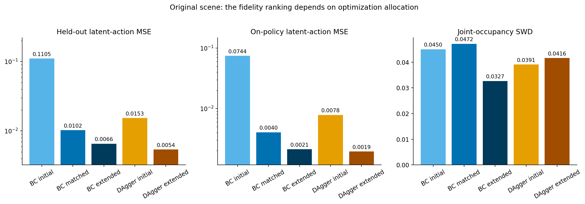
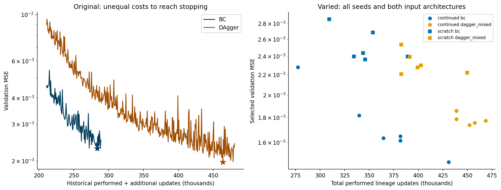
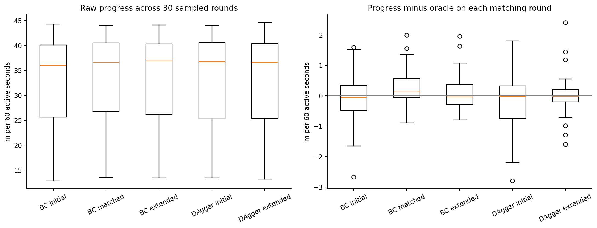
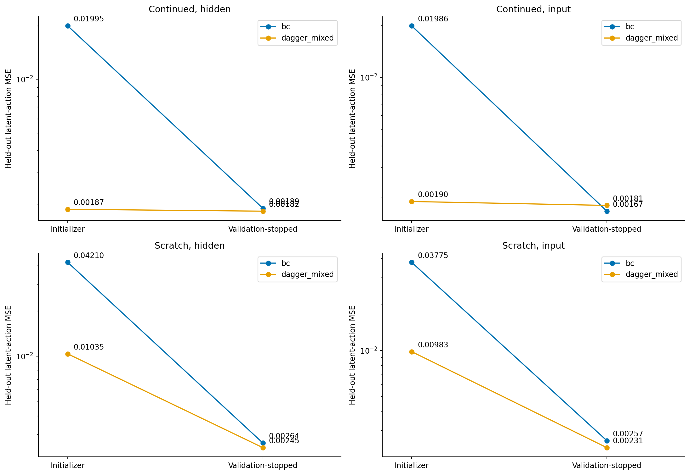
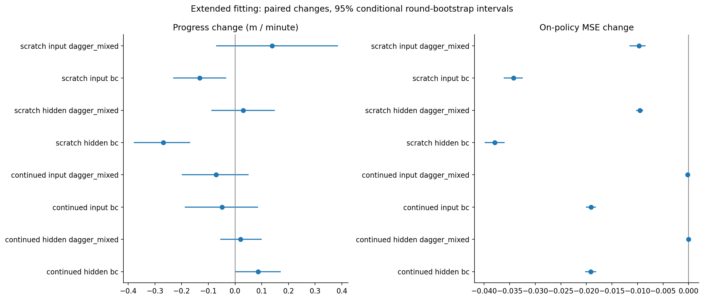
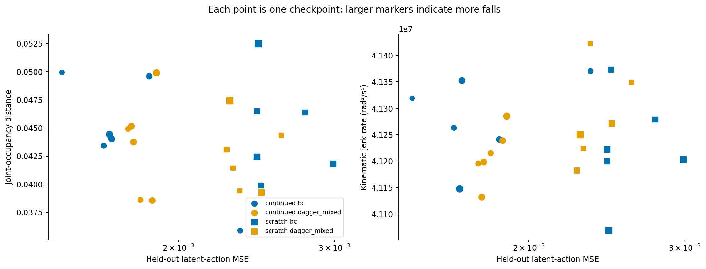
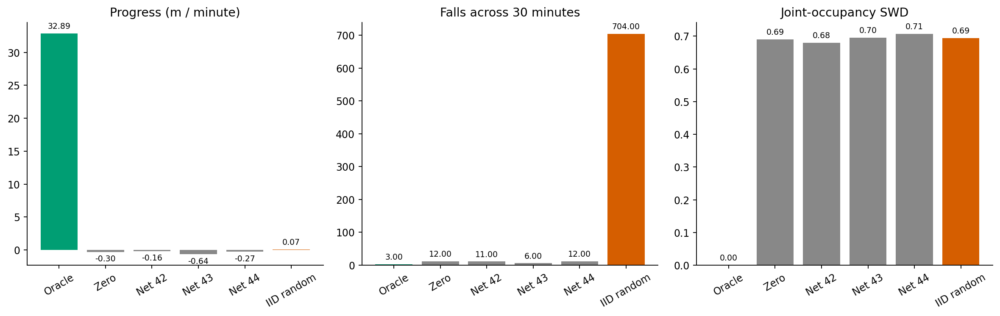
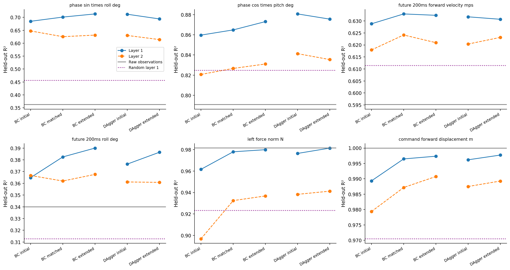
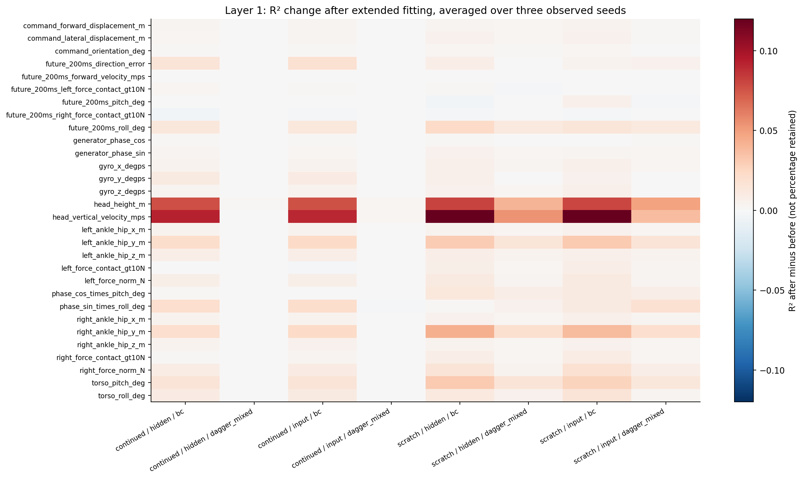
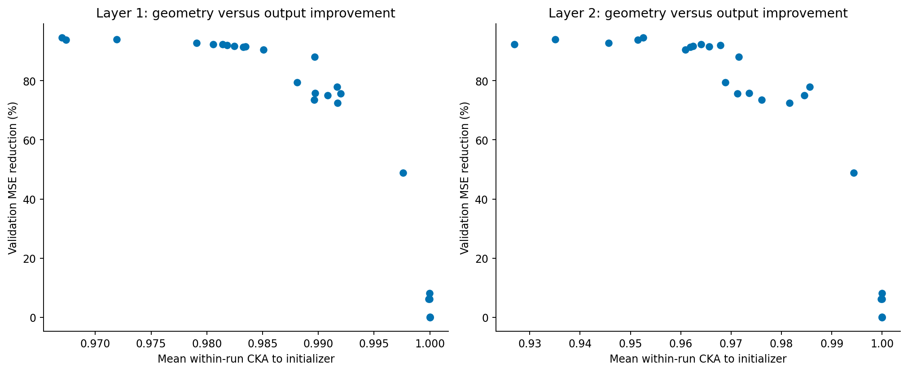

# Extended fitting, engine controls and representation probes

30 October 2026. This is an exploratory follow-up to the fixed-budget comparisons,
not a replacement for them. All earlier checkpoints, evaluations and reports are
preserved. [Figure atlas: 11 pages](EDA_FIGURES.pdf).

## Main findings

1. **The original fidelity ranking changes again after extended fitting.** DAgger
   now has lower original-scene held-out and on-policy latent-action MSE than BC.
   However, it used 480,375 total performed optimizer updates versus BC's 288,855.
   This does not overturn BC's advantage at the earlier matched-update endpoint.
2. **Much of the large varied-scene fidelity gap shrinks.** Continued hidden BC
   improves from 0.019949 to 0.001889 held-out MSE; continued hidden DAgger finishes
   at 0.001821. The two are close on this measure after additional fitting.
3. **Better imitation is not automatically better deployment performance.**
   Varied-only hidden BC improves action fidelity markedly, but loses 0.269 m of
   mean progress per minute and records seven rather than one fall over 90 minutes.
4. **The random-network control fails to make useful progress.** Its outcomes
   resemble zero native actions much more than trained walking. Staying upright
   and low jerk are insufficient success criteria on their own.
5. **Probes do not supply a simple explanation for the fidelity ranking.**
   DAgger's action prediction improves while its phase × roll readout weakens.
   High similarity to an initializer can coexist with substantial output gains.
6. **Repeated evaluation has visible variation even with identical weights.**
   Two fits select epoch zero. Their unchanged policies nevertheless produce
   different progress and fall counts when evaluated again on the same scheduled
   tasks. Small effects require cautious interpretation.

## 1. What was completed and what was checked

The completed batch contains 26 supervised extensions: original BC and mixed
DAgger, plus BC/DAgger × continued/scratch × hidden/input × seeds 42/43/44 on varied
surfaces. Three untrained networks provide engine controls. All 26 fits reached
the configured validation-patience condition; none reached the 1,000-additional-
epoch cap. Together they performed 6,476 additional epochs and 4,306,540 additional
optimizer updates. These are diagnostic expenditures, not equal per-method costs.

The batch completed **982 new 60-active-second deployments**. Its report contains
2,002 rows including 1,020 reused references. Merging the prior consolidated,
scratch and optimization-control reports gives **3,205 unique deployments**
(53.42 active hours), with duplicates checked by round, checkpoint and metrics.
Recovery time is excluded from active-time denominators.

All 29 model receipts, 982 new deployment receipts and the completed report were
verified against their stored output hashes. Oracle traces and evaluated model
hashes were checked before probing. No new simulation or policy fitting was
performed during this analysis.

Every extension uses its existing fixed 170,000-example training set and existing
10,000-example validation pool. The optimizer is restored alongside the selected
checkpoint. Epoch zero is eligible for selection. Validation patience is 25,
minimum duration 25 additional epochs, and the material-improvement threshold is
an absolute MSE reduction of 1e-5. Any lower validation loss can select a checkpoint;
only a material improvement resets patience. Consequently, the selected epoch
need not be exactly 25 epochs before stopping.

For DAgger, this is further fitting of the **saved final aggregate**. It does not
collect new learner-state labels or establish convergence of interactive DAgger.
“Validation-stopped” is more precise than “fully converged.” GAIL was not retrained
in this batch; its earlier fixed-budget evidence remains separate.

## 2. Original scene: three allocations give different answers

Each row below averages five original-scene task seeds. MSE is elementwise error
in the **16 native latent gait actions**, not joint-velocity error. SWD compares
standardized 22-joint occupancies and does not retain temporal ordering.

| Controller | Performed lineage updates | Held-out action MSE | On-policy MSE | Joint SWD | Progress m/min | Forward m/s | Falls / active min |
|---|---:|---:|---:|---:|---:|---:|---:|
| Oracle | — | — | 0 | 0 | 44.446 | 0.7590 | 0 / 5 |
| BC, initial 100 epochs | 66,500 | 0.110467 | 0.074445 | 0.04503 | 44.630 | 0.7591 | 0 / 5 |
| BC, matched updates | 211,050 | 0.010240 | 0.004033 | 0.04716 | 43.906 | 0.7470 | 0 / 5 |
| DAgger, original endpoint | 211,050 | 0.015345 | 0.007821 | 0.03909 | 44.364 | 0.7517 | 0 / 5 |
| BC, validation-stopped extension | 288,855 | 0.006561 | 0.002116 | 0.03269 | 44.171 | 0.7507 | 0 / 5 |
| DAgger, validation-stopped extension | 480,375 | 0.005401 | 0.001943 | 0.04158 | 43.984 | 0.7474 | 1 / 5 |

The initial DAgger advantage, matched-update BC advantage, and extended-fitting
DAgger advantage are all valid descriptions of **different allocations**. It would
be misleading to choose one endpoint and declare the algorithm intrinsically best.

BC reduces held-out MSE a further 35.9% from its matched checkpoint. DAgger reduces
it 64.8% from its original endpoint. DAgger's final held-out error is approximately
17.7% below BC's, and its on-policy error approximately 8.2% below BC's. But DAgger
uses approximately 66.3% more total performed updates. BC has lower joint SWD,
slightly higher progress and no observed fall. There is no single overall winner.

BC stops after 117 additional epochs, selecting epoch 109; DAgger stops after 405,
selecting epoch 380. Total performed cost includes epochs discarded by validation
selection. It is not the selected checkpoint's exact optimizer step count.

The left plot starts at the two inherited 211,050-update checkpoints and includes
only newly observed validation curves. It is not a reconstruction of all historical
training. The varied-scene endpoints on the right retain their unequal inherited
costs. Neither plot is a return-versus-environment-interaction curve.

## 3. Frozen original policies on sampled surfaces

These models receive no varied-surface training. Both extended original policies
are evaluated on the same 30 sampled fixed-slip/task rounds as their predecessors.
The sampled distribution spans approximately 0.000285–8.959668. Each run has one
fixed surface value; it is not resampled at each contact.

| Controller | Progress m/min | On-policy MSE | Joint SWD | Falls / active min | SD of paired oracle-progress difference, m |
|---|---:|---:|---:|---:|---:|
| Initial BC | 32.828 | 0.290978 | 0.09835 | 11 / 30 | 0.932 |
| Matched-update BC | 33.151 | 0.013429 | 0.04623 | 0 / 30 | 0.625 |
| Extended BC | 33.008 | 0.005212 | 0.03780 | 0 / 30 | 0.663 |
| Initial DAgger | 32.646 | 0.026471 | 0.06570 | 6 / 30 | 1.062 |
| Extended DAgger | 32.901 | 0.004926 | 0.04441 | 0 / 30 | 0.751 |
| Oracle | 32.885 | 0 | 0 | 3 / 30 | 0 |

Extended DAgger's sampled progress minus extended BC's is −0.107 m/min, with a
conditional paired-round 95% bootstrap interval of [−0.258, +0.039]. Its on-policy
MSE is lower by 0.000286. Both record zero falls here. These observations support
improved imitation and stability relative to the early underfitted policies, not
a resolved task-progress advantage of one extended model over the other.

Raw progress SD is about 9.6 m across rounds, much larger than the paired
oracle-relative SD. Across the balanced 26-extended-policy × 30-round panel,
shared round effects account for **99.74%** of progress sum of squares, controller
means for 0.013%, and the residual for 0.249%. A round changes both surface and
task: this is not evidence that slip alone explains 99.74% of variation.

The new panel's pooled progress–jerk Spearman correlation is 0.927; after removing
each round's mean it is 0.324. Progress–on-policy-MSE correlation changes from
−0.301 to −0.014. Shared test conditions can create strong pooled relationships
that are weak within matched conditions. Residual correlations remain descriptive,
not causal estimates or independent-sample significance tests.

## 4. Varied training: large fidelity differences mostly narrow

“Continued” retains original-scene pretraining before varied training. “Scratch”
denotes a lineage initially trained directly on varied surfaces; the extension
itself resumes its saved checkpoint. Scratch BC starts from the **200-epoch
optimization control**, not the earlier 100-epoch scratch checkpoint. Each family
below averages three observed training seeds and 30 sampled rounds per seed.
Repeated held-out MSE entries are the same checkpoint/test-set score, not 90
independent offline measurements.

| Family | Initial held-out MSE | Extended held-out MSE | Initial → extended progress m/min | Initial → extended falls / 90 min |
|---|---:|---:|---:|---:|
| Continued hidden BC | 0.019949 | 0.001889 | 32.784 → 32.870 | 4 → 5 |
| Continued hidden DAgger | 0.001866 | 0.001821 | 32.844 → 32.865 | 5 → 5 |
| Continued input BC | 0.019857 | 0.001671 | 32.883 → 32.834 | 6 → 4 |
| Continued input DAgger | 0.001902 | 0.001805 | 32.853 → 32.782 | 8 → 6 |
| Scratch hidden BC | 0.042104 | 0.002635 | 33.015 → 32.746 | 1 → 7 |
| Scratch hidden DAgger | 0.010345 | 0.002454 | 32.917 → 32.947 | 4 → 3 |
| Scratch input BC | 0.037746 | 0.002570 | 33.067 → 32.935 | 4 → 3 |
| Scratch input DAgger | 0.009826 | 0.002313 | 32.797 → 32.935 | 8 → 3 |

Continued hidden BC's error was roughly 10.7 times DAgger's; it is now roughly
1.04 times as large. For input-conditioned continued models, BC now has the lower
mean held-out and on-policy MSE. The earlier large algorithm gap therefore cannot
be discussed independently of the stopping and update allocation.

Continued DAgger changes relatively little: it stops after 25–70 additional epochs,
and two replicas select their inherited checkpoint. Continued BC takes 217–448
additional epochs. Scratch BC takes 265–385, and scratch DAgger 258–359. These
different costs are part of the result rather than a hidden fairness assumption.

Continued models retain lower held-out MSE than scratch models, but the absolute
gaps shrink substantially. For hidden BC the gap falls from approximately
0.02216 to 0.00075. Pretraining history is still associated with the endpoint,
but unequal inherited budgets and different datasets remain. This is not a clean
causal estimate of the benefit of pretraining alone.

## 5. Imitation gains can coexist with small task losses

Scratch hidden BC reduces its held-out error by about 93.7% and on-policy error
from 0.040559 to 0.002666. Yet progress falls by **0.269 m/min** [−0.380, −0.168],
with changes of −0.299 on the first 15 rounds and −0.239 on confirmation rounds.
Falls rise from 1 to 7 over the 90 deployments. Input-conditioned scratch BC also
loses 0.132 m/min [−0.231, −0.034], while its fall count decreases from 4 to 3.

These losses are small relative to roughly 33 m/min of task progress. They are
still informative: optimizing expert-action error is not identical to optimizing
progress, and stability does not always move in the same direction as either.
The data do not establish a general “overtraining harms control” law, and
checkpoint selection must remain validation-based rather than retrospectively
selecting whichever deployment is most favorable.

Among extended varied-only hidden models, DAgger exceeds BC progress by 0.202
m/min [0.107, 0.310] and records 3 versus 7 falls. Their held-out MSEs are close,
and DAgger's on-policy MSE is slightly higher (0.002722 versus 0.002666). This is
another reason to retain both task and fidelity measurements.

### Explicit context after extended fitting

Input minus hidden progress differences are:

| Family | Mean difference m/min | Conditional 95% interval |
|---|---:|---:|
| Continued BC | −0.036 | [−0.154, +0.079] |
| Continued DAgger | −0.083 | [−0.181, +0.013] |
| Scratch BC | +0.189 | [+0.065, +0.318] |
| Scratch DAgger | −0.012 | [−0.130, +0.111] |

The scratch-BC contrast is about 0.6% of mean progress and points in the same
direction on the first and confirmation halves. It is an exploratory exception
to the otherwise unresolved context effects, not evidence that context generally
improves locomotion. It also partly reflects hidden scratch BC's deterioration
under extended fitting. No multiplicity correction or training-population
uncertainty is included in these intervals.

### Mechanical interpretation

Original extended BC has lower SWD than extended DAgger despite higher action
MSE. On varied surfaces, most family-level SWD-change intervals overlap zero.
Their mean kinematic jerk rates remain around 4.1×10⁷ rad²/s⁶. Lower latent error
does not guarantee closer occupancy, fewer falls or smoother motion. Kinematic
jerk is not torque, energy consumption or physical hardware damage.

The legacy direction-error metric is deliberately retained, not silently repaired.
It mixes 20 ms evaluation increments with 40 ms visual localization refreshes and
assigns error 1 when displacement is undefined. Its absolute value therefore has
a sampling penalty. See the [prior localization audit](../exploratory_2026-10-29/REPORT.md).
Velocity means should not simply be doubled; zero and doubled increments can
preserve average velocity. Tracking claims need a separately versioned correction.

## 6. Engine control: random-network features do not make a walking controller

These networks have the normal 63→256→256→16 architecture, default seeded random
weights, genuine observations and fixed weights throughout deployment. Their
native action outputs enter the existing gait/filter/IK machinery unchanged.
They are different from IID uniform-random actions or randomized observations.

| Controller | Original progress m/min | Original falls / 5 min | Sampled progress m/min | Sampled falls / 30 min |
|---|---:|---:|---:|---:|
| Oracle | 44.446 | 0 | 32.885 | 3 |
| Zero native action | −0.105 | 0 | −0.303 | 12 |
| Random network 42 | −0.108 | 0 | −0.159 | 11 |
| Random network 43 | −0.291 | 0 | −0.637 | 6 |
| Random network 44 | −0.090 | 0 | −0.274 | 12 |
| IID uniform-random action | −1.159 | 151 | +0.065 | 704 |

The three random networks average −0.357 m/min on sampled surfaces. Their mean
paired difference from zero actions is −0.054 m/min [−0.112, +0.001]. None
approaches expert task progress. Their low original-scene fall counts and much
lower jerk reflect limited useful movement, not superior walking control.

This rejects the specific suggestion that the tested default random networks or
zero actions already reproduce expert progress through the engine. It does not
show that the engine is unimportant, nor test every possible constant action,
expert-mean action, action scale or random-network distribution.

## 7. An incidental but important repeatability control

Two continued DAgger extensions select epoch zero. Their initial/final weight
tensors are exactly equal, checked explicitly rather than inferred from MSE or
serialization hashes. New and historical evaluations use matching task rows.

| Identical-weight comparison | Mean progress change m/min | SD of paired change m | Largest absolute paired change m | Old → new falls / 30 min |
|---|---:|---:|---:|---:|
| Hidden seed 43 | +0.007 | 0.779 | 2.015 | 2 → 1 |
| Input seed 44 | −0.217 | 0.882 | 2.360 | 2 → 3 |

This is measured repeat variation, not an effect of learned parameter changes.
It shows why a few tenths of a metre or one extra fall should not be assigned a
mechanistic explanation without replication. These two cases do not estimate
the simulator's variance for every policy, and should not be subtracted as a
universal correction from other results.

## 8. Probing the extended models and their initializers

The new study probes **56 checkpoints**: 29 new trained/control models, their
26 distinct initializers, and original 100-epoch BC. With two hidden layers each,
the expert, random architectures and raw/restricted-input controls, this produces
131 representations × four label conditions = **524 multitarget ridge fits**,
or 15,720 property scores across 30 predefined targets.

All see identical oracle trajectories. The existing split is retained: ten runs
(4,270 rows) train probes, five runs (2,132 rows) select ridge penalties, and
15 confirmation runs (6,403 rows) test them. Rows use stride seven and a ten-step
(200 ms) outcome horizon; episode-crossing/reset windows are excluded. Input
models receive the correctly encoded recorded slip. Slip itself is not a target.
Feature scaling uses training data only. Three trajectory-shuffled-label controls
are fitted for each representation. The expert's actions reproduce the recorded
oracle actions within the existing tolerance.

The method reuses [Alain and Bengio's linear-probe motivation](https://arxiv.org/abs/1610.01644),
adapting the readout to continuous ridge regression;
[Hewitt and Liang's control-task motivation](https://aclanthology.org/D19-1275/);
and [Kornblith et al.'s linear CKA](https://proceedings.mlr.press/v97/kornblith19a.html).
The controls are adapted locomotion diagnostics, not reproductions of the NLP task.

### Readouts do not follow a single performance ranking

| Layer-1 property | Raw inputs R² | Random-network mean R² | Matched BC R² | Extended BC R² | Initial DAgger R² | Extended DAgger R² |
|---|---:|---:|---:|---:|---:|---:|
| Phase sine × roll | 0.3624 | 0.4559 | 0.7011 | 0.7132 | 0.7121 | 0.6939 |
| Phase cosine × pitch | 0.7908 | 0.8247 | 0.8649 | 0.8731 | 0.8807 | 0.8756 |
| Next-200-ms mean forward velocity | 0.5951 | 0.6114 | 0.6329 | 0.6324 | 0.6317 | 0.6307 |
| Roll 200 ms later | 0.3400 | 0.3128 | 0.3825 | 0.3900 | 0.3764 | 0.3865 |

DAgger improves action fidelity while its phase × roll R² falls from 0.7121 to
0.6939. Extended BC has the stronger readout but worse original action MSE.
Thus the earlier phase × roll explanation does not survive as a simple predictor
of the fidelity ranking. Future-velocity readouts also change very little despite
large reductions in action error.

The largest mean layer-1 gains among varied BC extensions occur for head vertical
velocity (+0.1055 R²) and head height (+0.0788). Both are already supplied in the
observation. Improved accessibility is not newly acquired physical information
or proof that the controller uses it. The complete 30-target heatmaps prevent
these examples from standing in for the full, mixed pattern of changes.

Layer 2 has its own [complete target-change figure](figures/09_all_probe_changes_h2.png).
No aggregate “percentage of all internal representations found” is meaningful.

The exact random networks that fail the engine test still have layer-1 command
displacement R² of 0.968–0.973 and future-velocity R² of 0.610–0.613 on oracle
states. This directly demonstrates the distinction between **decodable information
on a shared state bank** and **successful use of information in control**. Their
future readout predicts outcomes under oracle actions, not their own failed future.

The expert is a smaller 64-tanh hidden representation, whereas students use
256-ReLU layers. A student readout exceeding the expert's is not evidence of
superior control or “more than 100% knowledge transferred.” Raw-input controls,
random features, architecture and task-information differences must remain visible.
Trajectory shuffling can preserve periodic signals, so it is not a perfect
zero-information null. The future-direction label retains the localization caveat.

### High CKA permits substantial functional improvement

| Extended model vs exact initializer | Mean within-run layer-1 CKA | Layer-2 CKA | Original held-out MSE reduction |
|---|---:|---:|---:|
| BC vs matched BC | 0.9976 | 0.9944 | 35.9% |
| DAgger vs original DAgger endpoint | 0.9917 | 0.9856 | 64.8% |

Across all 26 pairs and both layers, mean within-run CKA ranges from 0.9269 to
1.0000. The identical-weight pairs give the expected identity comparison. Large
changes in prediction accuracy can occur with similar overall hidden geometry.
CKA is not the fraction of weights unchanged, a retained-knowledge percentage,
or a guarantee that two policies behave identically. Probe/CKA results here are
descriptive; no layer-reset causal interventions or R1 transfer tests were run.

## 9. What this supports in the paper

The strongest defensible organizing statement is:

> Task progress, imitation fidelity and mechanical stability are distinct outcomes.
> Their rankings depend on resource allocation, and the comparison must state
> whether it fixes optimization cost or applies a common validation-stopping rule.

The existing matched-budget results remain valid. The extended runs address the
loose end that both original methods were still improving, but do not supply a
new equal-budget ranking. They show that DAgger can reach a lower action error at
greater observed fitting cost, while BC remains competitive on task performance
and occupancy. Continued varied DAgger was already close to this stopping rule;
continued BC's large earlier deficit was substantially reducible by extra fitting.

For an eight-page paper, Figures 1 and 3 and a compact version of the resource
table carry the main new contribution. Figure 6 closes the engine-baseline concern.
One paragraph using the phase × roll reversal and high-CKA/output-improvement
contrast is a stronger probing contribution than a broad list of represented
properties. The full tables, all-target heatmaps and conditional effects can remain
in this supplementary report. The paper and slide deck have not been rewritten
as part of this analysis.

## 10. Limits on uncertainty and reproducibility

- Sampled contrasts pair the same 30 surface/task rounds. Training replicas are
  averaged within each round before 5,000 bootstrap resamples, stratified by suite
  and parent Gaussian group. Intervals condition on these checkpoints and mixture;
  they do not describe a population of independently trained agents.
- There are three varied-training seeds, one original training lineage, and shared
  original parents for continued models. Seeds must not be treated as fully
  independent histories. Offline test scores are not repeated observations per run.
- Confirmation runs were held out from probe fitting but had already been examined
  in earlier evaluation. This is not newly blinded confirmation. Numerous exploratory
  contrasts are reported without multiplicity adjustment.
- Identical-weight repeats reveal run variation. Bootstrap intervals across task
  rounds do not by themselves model all simulator or training randomness.
- A common stopping rule is standardized; its resource cost is not fixed. No
  mathematical/global convergence or converged online DAgger claim is made.
- Probe test results do not select policies. Original checkpoints and artifact
  receipts are unchanged. Code, source hashes, numeric tables and figure outputs
  are stored alongside this report; raw fitted probes stay under experiments/.

See [README](README.md) for commands and [manifest](manifest.json) for input hashes.
