# Exploratory analysis of the completed Walker experiments

**29 October 2026 · saved-data analysis, no new training or simulator runs**

This analysis broadens the evidence beyond the existing paper narrative. It follows the proposal's three measurement groups—resources, imitation fidelity, and locomotion/stability—while asking which comparisons survive pairing, which averages conceal variation, and which measurements need qualification. It does not replace the historical reports or select new checkpoints on test performance.

**Start with the [12-page figure atlas](EDA_FIGURES.pdf).** Every figure is also available as a PNG and vector PDF in [figures](figures/). The [reproduction guide](README.md) describes the script, data sources and exported tables.

## Main findings and their evidential strength

| Finding | Evidence | Appropriate interpretation |
|---|---|---|
| Shared surface/task rounds dominate variation in useful walking progress. | In a balanced 59-controller × 30-round panel, shared-round differences account for **99.48%** of progress sum of squares; controller means account for **0.05%**. | Compare controllers within rounds. This does **not** identify slip alone as the cause, or prove the oracle is optimal. |
| The pooled jerk–progress association is largely a between-round effect. | Spearman correlation **0.904** pooled, **0.022** after subtracting each round's mean. | A pooled “smoother means slower” interpretation is misleading; jerk must be contextualized by movement and conditions. |
| Matched-update BC improves the observed lower tail as well as average sampled progress. | Its mean of the three worst oracle-relative deficits is **−0.655 m**, versus **−1.922 m** for initial BC and **−2.384 m** for frozen DAgger. | A stronger reliability description than mean score alone, conditional on these checkpoints and 30 rounds. |
| Better imitation is not monotonically better task progress. | Varied-only hidden BC: **33.192 m**, MSE **0.11177**; continued hidden BC: **32.784 m**, MSE **0.01995**. | There is a task–fidelity trade-off in the observations; imitation and locomotion are separate objectives. History and optimization remain confounded. |
| Small context/GAIL progress differences are not consistently resolved. | All eight context and all eight varied GAIL-refinement progress intervals span zero under the stated round-bootstrap analysis. | No dependable general progress advantage is demonstrated here. This is not an equivalence test or proof of no effect. |
| The tracking metric has a measurement-rate artifact. | Original oracle traces have **50% exactly zero recorded displacement steps**; localization updates at 40 ms and actions at 20 ms. | Historical direction error includes a stale-position penalty. Preserve old results; audit the metric before making strong physical tracking claims. |
| Probe controls change the interpretation of “represented features.” | Original BC/DAgger h1 outperform random-feature readouts on **30/30** targets, but raw-observation readouts on only **10/30** and **11/30**. | Training preserves and reorganizes information; high absolute probe scores alone do not identify newly acquired control knowledge. |

The first, second and sixth findings are especially useful additions to the paper. The tail and fidelity–progress analyses strengthen existing conclusions without turning small differences into universal rankings.

## 1. What was included, and why

Three compatible evaluation reports were merged: consolidated evaluation, its scratch-initialization extension, and submission controls. Repeated records were checked for matching round identity, checkpoint hash and overlapping numeric metrics before deduplication.

- **2,223 unique deployments**, **66 controllers**, **37.05 active simulator hours**.
- **1,568 repeated report records** verified and removed from the analysis count.
- Original installed scene: **45 deployments**, nine controllers × five task seeds.
- Corrected scalar-slip nominal scene: **198 deployments**, 66 controllers × three task seeds.
- Sampled fixed-slip scenes: **1,980 deployments**, 66 controllers × 30 surface/task rounds.
- The latter comprise 15 initial grouped rounds and 15 confirmation rounds. Actual sampled slip spans **0.000285–8.959668**, held fixed throughout each deployment.
- A deeper audit covers **294 traces** from eight selected controllers: oracle, frozen BC, frozen mixed DAgger, matched-update BC, continued hidden BC seed 42, scratch hidden BC seed 42, zero-native action, and original random-start GAIL. All their available original, nominal and sampled deployments are included in `trace_summary.csv`.
- Existing representation reports supply all **30 predefined probe targets**. No probes were refitted.

Older experiments, smoke tests, obsolete environment-modification attempts, FiLM experiments and optional larger-budget GAIL runs are not pooled into this panel. They used different policies, budgets, protocols or physical configurations. The aim is broad coverage of the strongest compatible completed batch, not an inflated total assembled from incomparable runs. In particular, the original installed scene is **not** relabelled “zero slip” or equated to corrected scalar slip 0.1.

A deployment lasts 3,000 active steps, nominally 60 seconds. Recovery time is excluded. Training replicas are distinct from deployment rounds: varied families usually have three training seeds, while original models and matched original BC have one. Continued replicas share an original parent checkpoint.

## 2. Variability: the environment/task mixture matters more than the spread of policy means

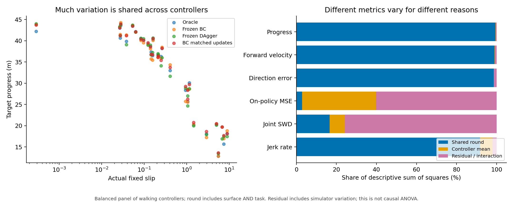

Among the 59 trained walking controllers, progress varies mainly with **which round is run**, rather than which checkpoint is used. A balanced two-way descriptive decomposition gives:

| Metric | Shared-round component | Controller-mean component | Residual/interaction |
|---|---:|---:|---:|
| Target progress | 99.48% | 0.05% | 0.47% |
| Forward velocity | 98.97% | 0.07% | 0.97% |
| Legacy direction error | 98.57% | 0.09% | 1.34% |
| On-policy latent-action MSE | 2.90% | 36.83% | 60.27% |
| Joint occupancy SWD | 16.67% | 7.55% | 75.78% |
| Jerk rate | 91.74% | 6.27% | 1.99% |

This is a sum-of-squares partition, **not a random-effects model, significance test, or causal ANOVA**. A round changes both slip and task seed. Residuals include controller-by-round interactions, state-dependent trajectories, and simulator variability; there are no repeated executions of every identical controller/round cell to separate these components. Similar GAIL descendants are also not independent algorithms; `variance_sensitivity.csv` repeats the progress calculation within algorithm families. Their shared-round fractions remain **99.27–99.71%**, so the broad result does not depend on pooling all four algorithm families.

The oracle's mean progress is **42.148 m** in the draws from the Gaussian centred at 0.025, versus **17.476 m** in the draws from the Gaussian centred at 10. Their actual mean slips are **0.02886** and **6.09628**. The approximately **58.5%** progress reduction is shared broadly by the learned policies. Because tasks also differ, this is descriptive evidence of the scene/task difficulty pattern, not an isolated causal slip effect.

This explains why near-oracle normalized scores can coexist with substantial absolute deterioration. The normalization denominator changes with the oracle on the same surface. An agent can track the oracle closely while both make much less progress.

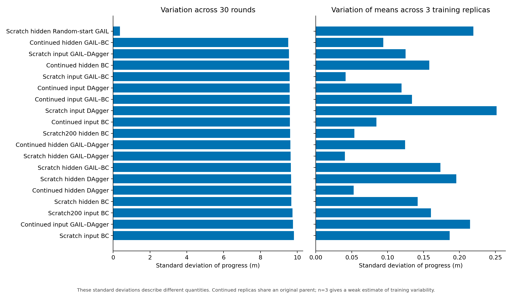

The useful standard deviations answer two different questions:

- **Across rounds for a fixed model:** typical progress SD is roughly 9.5–9.8 m because the evaluation intentionally mixes substantially different conditions.
- **Across the three trained replicas' 30-round means:** typically only a few hundredths to a few tenths of a metre. This measures variation among the observed fits, not general deployment robustness.

For continued hidden BC these quantities are **9.568 m** and **0.158 m**; for continued hidden DAgger, **9.682 m** and **0.053 m**. It would be misleading to give the smaller quantity as if it described robustness across deployment conditions. Conversely, the large raw SD mostly reflects the designed task/surface mixture and does not establish unstable control.

## 3. Reliability: use paired deficits and lower tails, not only average score

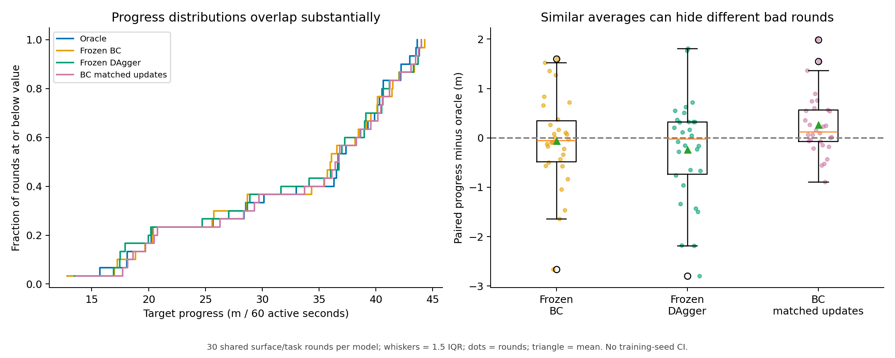

| Sampled controller | Mean progress | SD across rounds | Median progress | SD of paired oracle difference | Mean of three worst paired differences | Falls / active minutes |
|---|---:|---:|---:|---:|---:|---:|
| Oracle | 32.885 m | 9.610 m | 36.654 m | — | — | 3 / 30 |
| Frozen initial BC | 32.828 m | 9.695 m | 36.032 m | 0.932 m | −1.922 m | 11 / 30 |
| Frozen mixed DAgger | 32.646 m | 9.796 m | 36.747 m | 1.062 m | −2.384 m | 6 / 30 |
| Matched-update BC | 33.151 m | 9.465 m | 36.594 m | 0.625 m | −0.655 m | 0 / 30 |

The median is above the mean because the surface mixture includes low-progress rounds. It is not intrinsically a better summary: the mean reflects the chosen deployment mixture, while the median describes its central round. Reporting both reveals the shape.

Raw progress distributions overlap heavily. Paired differences remove much of the shared round effect and reveal that matched BC's observed shortfall distribution is tighter. It has no round more than 2 m below the paired oracle, compared with one for initial BC and three for frozen DAgger. The 2 m threshold is an exploratory descriptive threshold, not a predefined success criterion.

Matched BC exceeds frozen DAgger by **0.505 m** on average across the 30 sampled rounds; the stratified round-bootstrap interval is **[0.258, 0.761] m**. The difference is positive in both the first and confirmation sets: **0.585 m** and **0.426 m**. Relative to initial BC, the mean gain is **0.323 m**, interval **[0.106, 0.563] m**.

These intervals condition on the actual checkpoints and the designed mixture of task/surface groups. They do not include uncertainty over new training seeds, and the exploratory comparisons have no multiplicity correction. The lower-tail statistic uses only three observations per checkpoint and should not be presented as a precise population risk estimate.

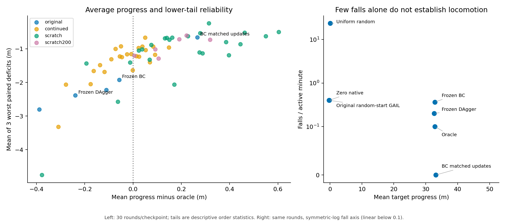

The zero-native and random-start GAIL controls also illustrate why stability must be assessed during **useful locomotion**. On these sampled rounds, their progress is approximately **−0.303 m** and **−0.216 m**, despite only **12 falls each** over 30 minutes. Uniform random has **704 falls** and essentially zero net useful progress. The walking policies should not be ranked as worse simply because an unproductive policy moves less or occasionally falls less.

## 4. Fidelity, task progress and mechanical cost do not form one ranking

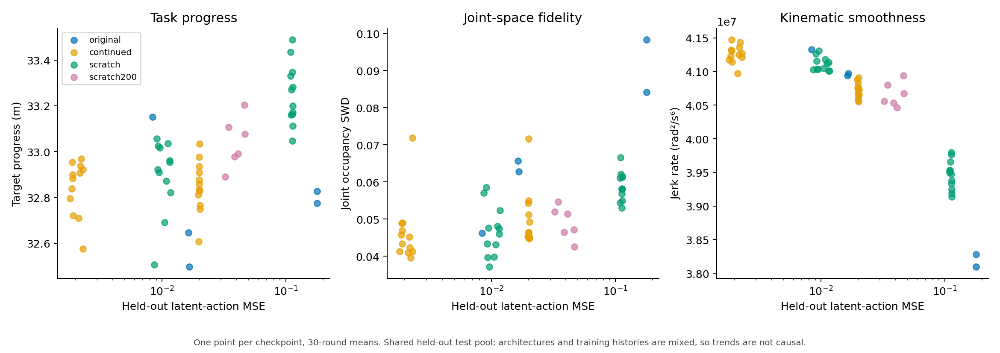

A clear example emerges when removing original-scene pretraining:

| Hidden BC training history | Expert-test MSE | On-policy MSE | Sampled progress | Falls / active minutes |
|---|---:|---:|---:|---:|
| Varied-only, 100 epochs | 0.11177 | 0.09922 | 33.192 m | 4 / 90 |
| Varied-only, 200 epochs | 0.04210 | 0.04056 | 33.015 m | 1 / 90 |
| Original 100 + varied 100 epochs | 0.01995 | 0.02109 | 32.784 m | 4 / 90 |

Continued BC is much closer to the oracle's actions, but its mean progress is **0.408 m lower** than varied-only 100-epoch BC. The difference appears in both round sets (**−0.407 m**, **−0.410 m**). Input-conditioned BC shows the same broad pattern: **−0.391 m** for continued versus varied-only progress.

Additional varied-only optimization reduces hidden BC's MSE by approximately **62.3%**, while progress decreases by **0.177 m**. The input-conditioned counterpart has approximately **66.4%** lower MSE and **0.207 m** less progress. These are small progress effects—roughly half a percent—but they make a useful conceptual point: **closer imitation need not maximize this particular task-progress measure**.

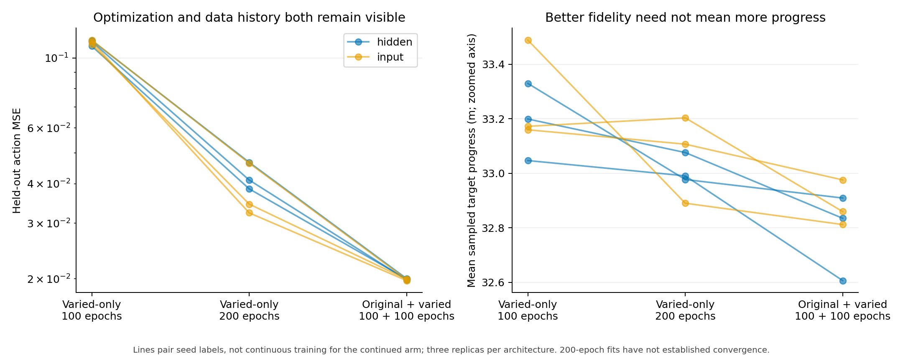

It would be premature to call this “negative transfer.” Continued models have different data histories, optimization trajectories, and potentially different mechanical priorities. There are only three replicas, and neither fitting schedule establishes convergence. The defensible statement is a descriptive trade-off, not a causal claim that pretraining damages locomotion.

For mixed DAgger, continued hidden models have held-out MSE **0.001866**, versus **0.010345** for varied-only models, but mean progress is **32.844 m** versus **32.917 m**. The sizeable fidelity difference again has little correspondence with useful displacement. The new matched BC control does not make the varied DAgger optimization budgets equal, so the original-scene budget conclusion cannot simply be extended to this comparison.

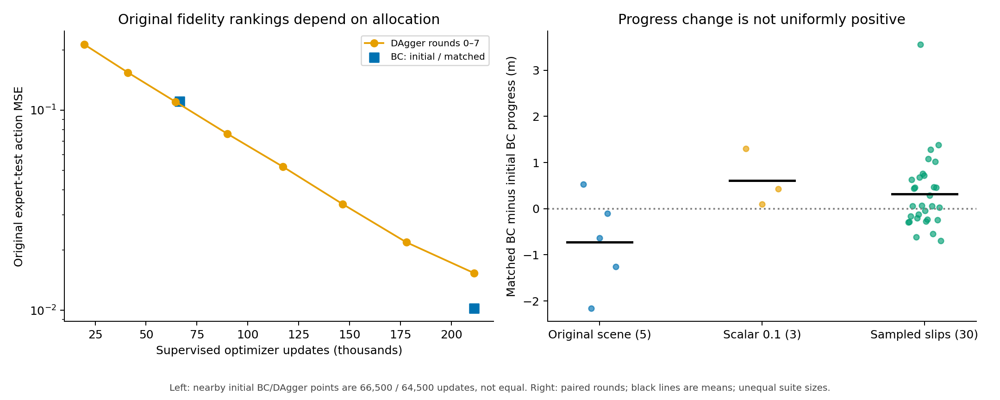

The original-scene allocation result remains important: initial BC gets 66,500 updates, while DAgger's nearby curve point is at 64,500; their MSEs are **0.11047** and **0.10995**. At the matched endpoint of 211,050 updates, BC gives **0.01024**, versus DAgger's **0.01535**. This supports optimization sensitivity, not proof that update count is the sole mechanism. Both final fits remain budget-limited.

There is a useful complication: matched BC's original-scene mean progress is **0.724 m below** initial BC, whereas its sampled-scene mean is **0.323 m above**. There are only five original-scene rounds; this is a lead about differing deployment effects, not a confirmed population interaction. It prevents the oversimplification that extra optimization improved every outcome everywhere.

## 5. Jerk needs conditioning; correlation alone gives a misleading mechanical story

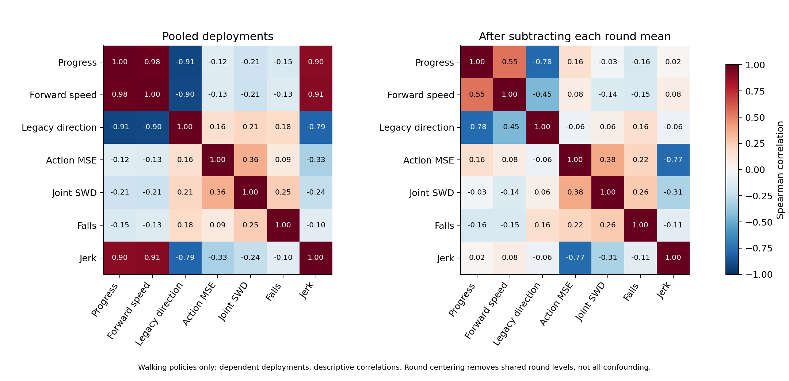

For the 1,770 sampled deployments of 59 trained walking controllers:

| Spearman association | Pooled rounds/controllers | After subtracting each round mean |
|---|---:|---:|
| Progress vs jerk rate | 0.904 | 0.022 |
| Progress vs forward velocity | 0.980 | 0.546 |
| Progress vs joint occupancy SWD | −0.207 | −0.028 |
| Progress vs on-policy action MSE | −0.122 | 0.157 |
| Action MSE vs jerk rate | −0.326 | −0.767 |

These are descriptive associations among dependent measurements; no p-values are attached. Round centering changes the question to whether a controller is above or below the other controllers on the same round. It removes shared round levels, not all confounding by training history, architecture or policy behaviour.

The most useful conclusion is that the apparent progress–jerk relationship largely arises between rounds. Raw jerk cannot be read as a stand-alone smoothness superiority score, much less as energy or hardware wear. More faithful policies can have **higher** jerk, and low-activity controls can have low jerk without useful control. The proposal's mechanical-stability question is best answered by showing progress, falls, torso measures and jerk together, with jerk explicitly labelled as a **kinematic** quantity.

Fall counts are also uneven across sampled groups. Across the balanced walking-controller panel there are **48 falls in 354 deployments** in the parent-mean-10 group, versus **3 in 354** in the parent-mean-0.1 group. Other groups have 16–21 falls. This is a useful risk-location description; 354 deployments are not 354 independent surface draws—each group has just six paired rounds with related controllers.

## 6. Context and conservative GAIL: distinguish small estimates from reliable advantages

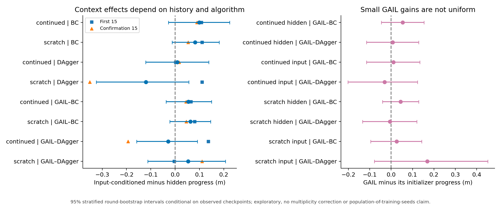

The estimates remain small compared with the effects of scene/task difficulty:

- Continued BC gains **0.099 m** from supplying slip; the three training-seed differences are **+0.066, +0.025, +0.206 m**. This is consistent in sign among these seeds, but the conditional round interval still spans zero: **[−0.028, +0.224] m**.
- Varied-only BC gains **0.082 m** on average, but seed effects are **−0.170, −0.027, +0.442 m**. Its apparent average benefit is not shared by every trained replica.
- Varied-only input-conditioned DAgger is **0.121 m lower** on average than hidden DAgger. Its first-set effect is **+0.110 m**, but confirmation is **−0.351 m**. A single averaged bar would hide this instability in sign.
- Varied GAIL's progress differences from its corresponding initializer range from about **−0.031 m to +0.168 m** across the eight architecture/history combinations. All conditional intervals span zero. The largest apparent gain, scratch input GAIL–DAgger, changes from **−0.123 m** in the initial set to **+0.460 m** in confirmation.

These results support a restrained conclusion: **the current experiments do not demonstrate a general progress benefit from explicit slip or conservative GAIL refinement**. That is stronger evidence than merely noting that means look close, but weaker than an equivalence test. These GAIL variants remain specific supervised-initialized, BC-regularized refinements at the recorded budget; this analysis does not evaluate the optional larger-budget recipe.

## 7. Error distributions: the original BC gap is not only a few catastrophic frames

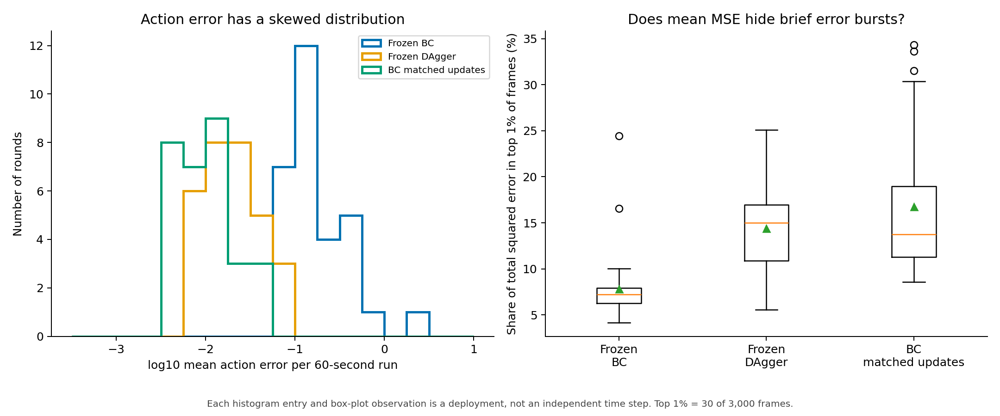

Across the 30 sampled traces, initial BC's average within-run median frame MSE is **0.1422**; matched BC's is **0.0064**. The average within-run 95th percentile falls from **1.4371** to **0.0452**. Thus the lower average error reflects a broad shift in everyday predictions, not only the removal of isolated extreme events.

The highest-error 1% of frames account, on average, for **7.8%** of initial BC's total squared error, **14.4%** of frozen DAgger's, and **16.8%** of matched BC's. A larger fraction does not mean the model is worse: once ordinary errors become small, residual bursts can contribute a larger proportion of a much smaller total. This is why the concentration plot must sit beside absolute MSE.

Frames are temporally correlated. These summaries are calculated inside each deployment and then compared across deployments; 3,000 frames are not treated as 3,000 independent experimental repetitions.

## 8. Measurement audit: unchanged localization is not standing still

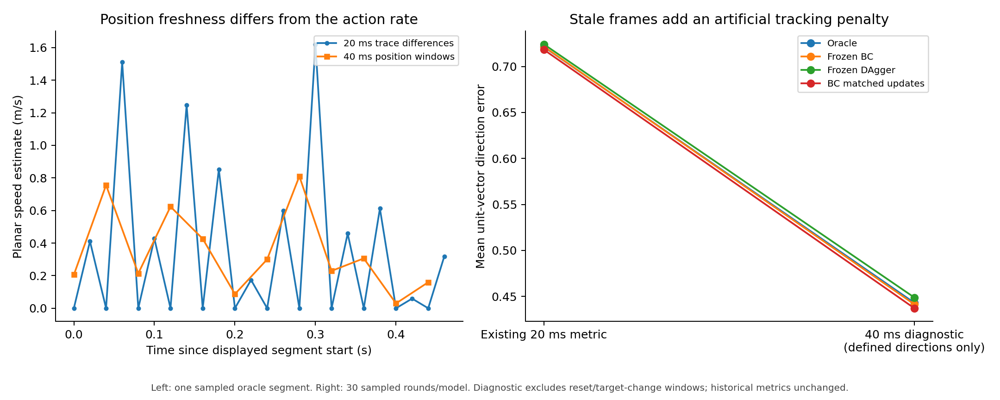

This is the most actionable new issue discovered by the exploration.

The evaluator computes displacement every **20 ms** from `loc_head_position`. `World.update` refreshes visual localization only when a vision message arrives; the robot code documents **40 ms** position-history intervals. The original-scene oracle traces contain exactly **50% zero recorded speeds**. In an example sampled oracle trace, all even steps are zero and all odd steps nonzero.

The evaluator assigns direction error **1** when displacement is too small to define a movement direction. Consequently, with half stale frames the reported average is approximately:

`legacy mean direction error = 0.5 × 1 + 0.5 × mean error on updated frames`.

This compresses differences and adds an artificial offset. It does not mean the oracle spends half its deployment stationary, and it does not invalidate accumulated progress by itself.

A separate offline diagnostic uses non-overlapping 40 ms position windows, excludes reset and target-change windows, and evaluates direction only where displacement and target vectors are defined:

| Original-scene controller | Historical direction error | 40 ms diagnostic direction error |
|---|---:|---:|
| Oracle | 0.65712 | 0.31468 |
| Initial BC | 0.65450 | 0.30959 |
| Mixed DAgger | 0.65834 | 0.31735 |
| Matched BC | 0.66219 | 0.32476 |

The diagnostic preserves the broad ordering in this subset, but changes the physical interpretation of the absolute values. Original-oracle apparent low-speed fraction below 0.1 m/s is **50.06%** in the 20 ms trace, versus **0.375%** in valid 40 ms windows. This threshold was used to diagnose the sampling artifact, not to define a new success metric.

**Do not overwrite published tracking numbers with this table.** The diagnostic differs in windowing and exclusions and is not a complete new protocol. A defensible correction should record localization freshness/timestamps, explicitly handle undefined directions, evaluate all controllers consistently, and version the metric. Existing total progress and minute-average velocity do not automatically require a factor-of-two correction: alternating zero and doubled increments can preserve time averages. Instantaneous speed and stopping claims require special care.

The existing `future_200ms_direction_error` probe target averages the legacy direction metric, so its physical label inherits this caveat. This does not invalidate phase×roll, contact, or other unrelated probe targets. Localization freshness also deserves auditing before interpreting any instantaneous position-derived quantity. No training or evaluation code has been changed in this EDA.

## 9. Probes: focus on what learning adds beyond the input and random features

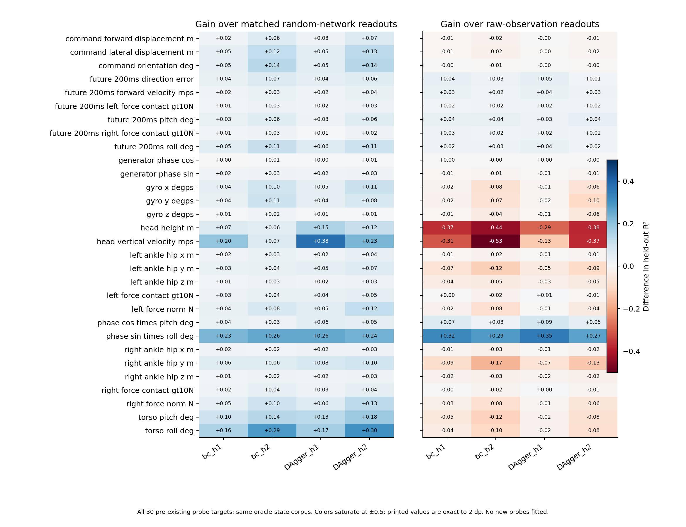

The complete 30-target view is more informative than a selected high R²:

- Original BC h1 beats the matched random-network mean on **30/30** targets; original DAgger h1 also does so on **30/30**. At h2, both still beat the random mean on all targets.
- Against **raw observations**, those counts fall to **10/30** for BC h1, **11/30** for DAgger h1, and **8/30** for each h2. These are descriptive counts of positive differences, not statistically significant target discoveries.
- For torso roll, raw observations give R² approximately **1.000**, while BC and DAgger h1 give **0.9625** and **0.9775**. This is information preservation through the learned network, not discovery of a previously unavailable variable.
- For phase×roll, the raw baseline is **0.3624**, random h1 mean **0.4559**, BC h1 **0.6847**, and DAgger h1 **0.7121**. Here learned features make a nonlinear combination substantially more linearly accessible than either control.
- Future forward velocity is less discriminative: raw **0.5951**, random h1 **0.6114**, BC h1 **0.6288**, DAgger h1 **0.6317**. Most of the high absolute predictability is already present without learned imitation features.

**Layer choice matters.** DAgger beats BC on phase×roll at h1, but at h2 BC is higher (**0.6475 versus 0.6300**). A single-layer story about which algorithm “understands balance better” is therefore not robust even within this target. The features, ridge fitting and target definition jointly determine readout quality.

All these targets come from the shared oracle-state corpus. Decodability does not establish that a policy uses a feature for control, and it does not explain its performance on its own visited states automatically. CKA likewise compares representation geometry, not usefulness. The new matched BC control has not been probed, so existing feature differences cannot explain its later optimization-controlled advantage.

A defensible representation conclusion is: **training preserves input information and makes selected phase-dependent combinations more accessible to a linear readout, while high predictability and representation similarity alone do not establish causal control benefits.** This connects the probing results to the fidelity/performance separation without inventing a transfer claim.

## 10. Recommended use in the paper and presentation

The proposal does not require every exploratory result in the final eight-page body. The most effective visual sequence would be:

1. **Allocation curve plus endpoint control** (Figure 12 left): answers the resource question and qualifies algorithm rankings.
2. **Actual slip versus absolute progress, alongside the round decomposition** (Figure 2): demonstrates real environmental deterioration despite normalized parity.
3. **Paired deficit box plots** (Figure 1 right): shows reliability differences hidden by similar averages.
4. **Fidelity versus progress/SWD** (Figure 8, two selected panels): separates imitation from successful locomotion.
5. **One controlled probe panel**, if space remains: phase×roll plus future velocity with raw and random baselines, and the layer caveat.

The correlation matrices, full probe heatmap, seed-variation panels and error histograms are useful supplementary material or supervisor discussion figures. The measurement-rate audit belongs in methods/limitations and should be resolved before stronger tracking interpretations are finalized.

Avoid a universal leaderboard. A checkpoint can win on expert-action prediction, lose slightly on task progress, and have a different lower-tail profile. Equally, reporting all variance measures on every metric would add clutter: standard deviation is useful for consistency, quantiles for skew/tails, and the variance decomposition for locating sources of spread. We deliberately do not use coefficients of variation for near-zero or negative returns, Gaussian fall-count error bars, or timestep-level significance tests.

## 11. What would strengthen the evidence next

These are priorities suggested by the EDA, not experiments run here:

1. **Audit and version tracking measurements.** Record localization freshness; recompute a consistently defined movement-direction metric for all saved traces where possible. Preserve historical results and comparisons.
2. **Use identical target sequences/seeds across a factorial slip grid** if an isolated slip effect is required. Current pairing is across controllers within a round, while slip and task seed vary between rounds. Resets and target-reach events can also make realized trajectories diverge despite a shared seed.
3. **Repeat exact controller/round pairs** for a small planned subset to estimate simulator/restart variability separately from policy-by-round effects. The current residual cannot separate them.
4. **Run convergence diagnostics for both BC and DAgger**, if making a converged-method claim. The present resource comparison is a finite-budget one.
5. **Probe the new matched BC checkpoint only if representation explanations remain central.** Use both layers and raw/random controls; avoid adding a large probe appendix merely to search for a favourable target.

The strongest existing story is already substantial: resource allocation alters fidelity rankings; shared environment/task difficulty dominates displacement variation; useful movement, imitation fidelity and mechanical stability require different evidence; and readout similarity cannot substitute for controlled behavioural comparisons.

## Statistical and reproducibility notes

- All figures are descriptive or exploratory. There was no preregistered EDA selection, no multiple-comparison adjustment, and no newly untouched confirmation set: the existing confirmation rounds have already been examined in prior work.
- Round-bootstrap intervals average the three observed replicas **within each round**, then resample rounds within the ten suite × Gaussian-parent strata (three rounds per stratum), preserving mixture weights. They are conditional sensitivity intervals, not training-population uncertainty. With only three draws per stratum, tail uncertainty is especially poorly characterized.
- The first-set/confirmation split is shown to expose sign sensitivity, not to claim a newly independent validation exercise.
- Expert-test MSE is a checkpoint-level score on the same held-out pool for a domain. Copying it onto run records does not create independent offline measurements.
- On-policy MSE compares each agent to oracle labels on that agent's own visited states. It is not a comparison of all policies on identical states.
- The 16 outputs are native gait-generator actions; SWD concerns 22-joint **occupancy**, not time-ordered trajectories. Jerk is angular kinematic jerk, not measured torque, power or energy.
- Controller-level averages and exact fall totals are retained in downloadable CSVs. Source and trace hashes, dependencies and plot captions are in `manifest.json`.
