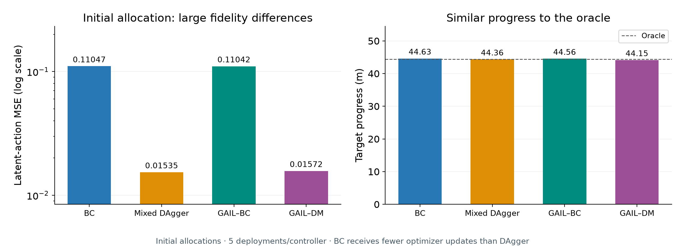
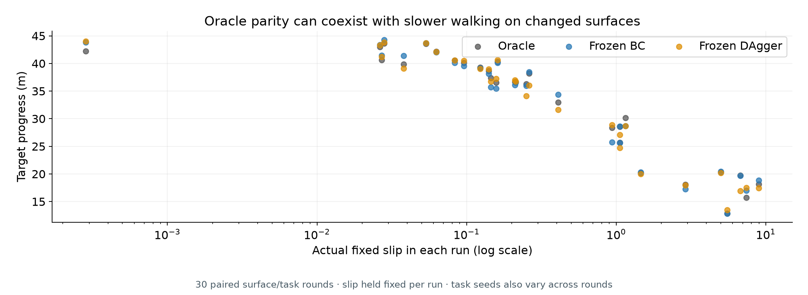
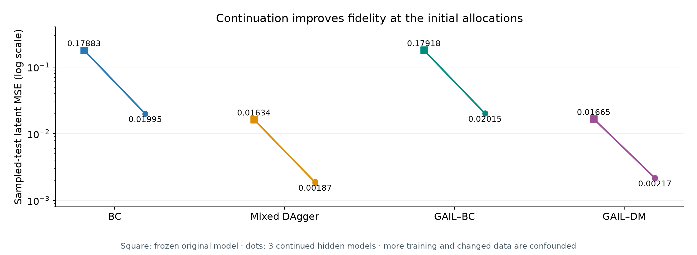
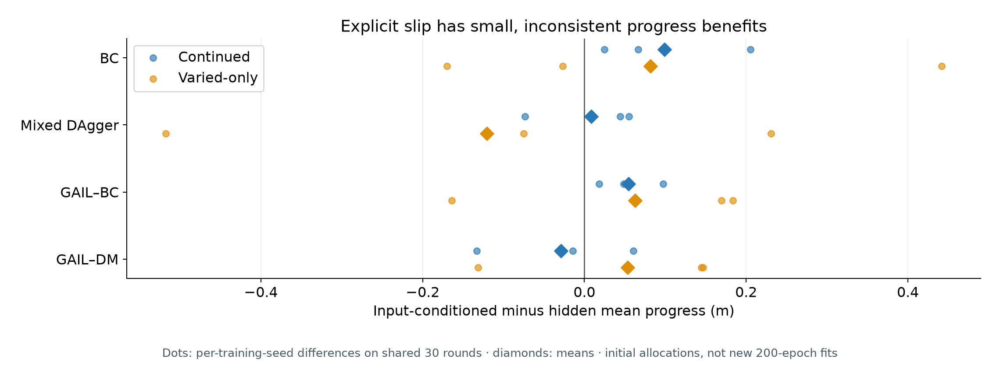
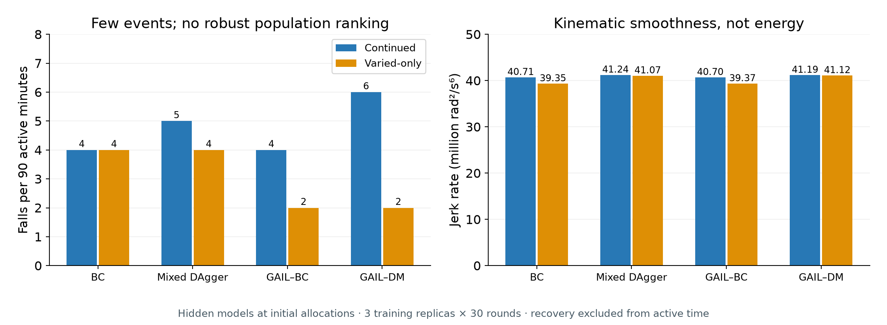
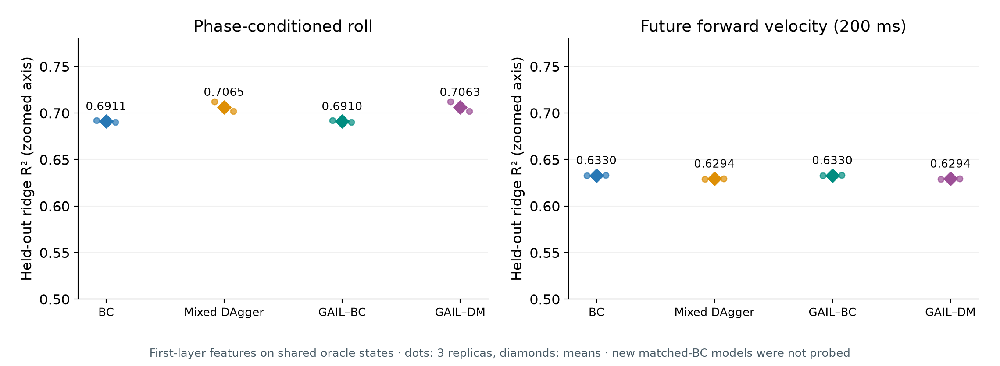
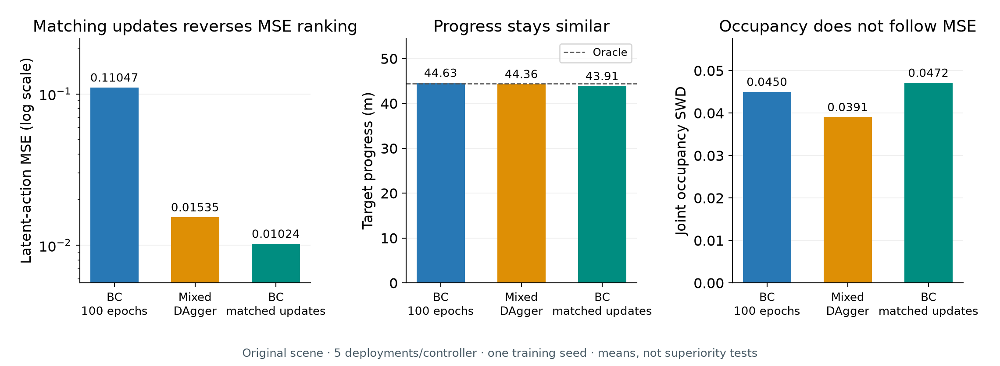
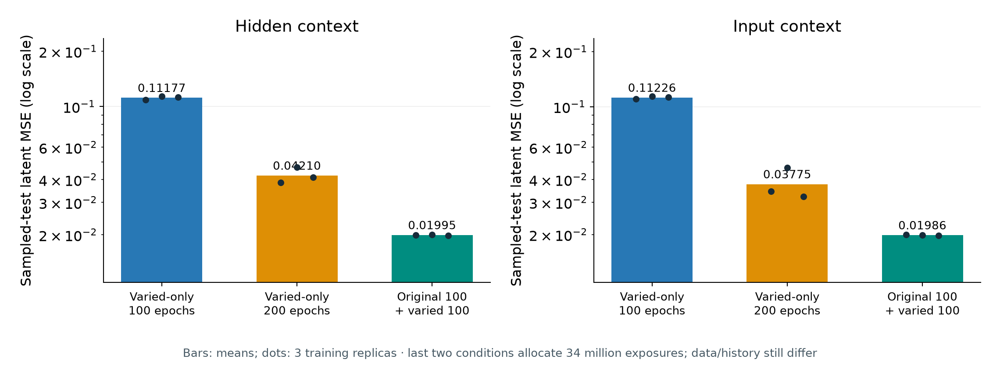
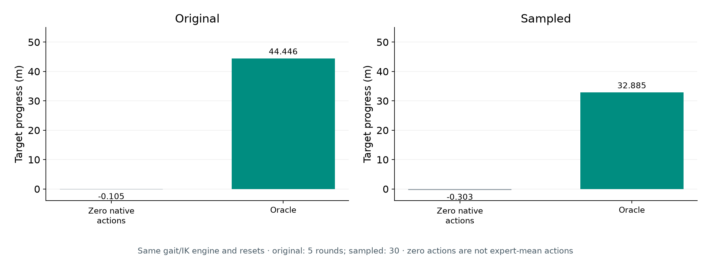
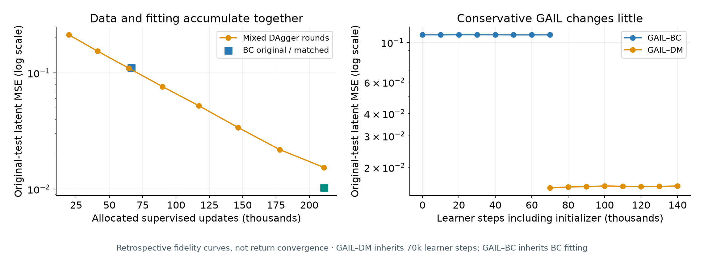

# 0 · Imitating RoboCup locomotion
## What the consolidated experiments establish

Original environment → varied surfaces → initialization → representations

**Similar walking performance does not imply similar imitation fidelity.**

A focused narrative for the final eight-page report.
[Background and slide notes](CONSOLIDATED_PAPER_NOTES.md)

<!-- Slide 0. References are outside the eight-page body limit. Historical experiments are followed by the completed budget and zero-action controls on slides16–19. -->

---

# 1 · Redid experiments — how and why

**Why:** historical runs used evolving collection, recovery and training procedures, making comparisons harder to interpret.

**How:** one consolidated protocol for BC, mixed DAgger, GAIL-BC and GAIL-DM:

- Long runs and short turns; shared control interface.
- Explicit allocations and managed synchronous servers.
- Common test rounds, fall handling and metrics.

**Outcome:** compare training protocols, not different generations of tooling.

<!-- Slide 1. GAIL-DM starts from mixed DAgger; FC Portugal remains the expert for every method. The old historical DAgger/GAIL lineage is separate. -->

---

# 2 · Research questions and evidence

| Research question | Evidence to prioritize |
|---|---|
| How stable are the learned controllers? | Falls, joint jerk, posture and useful movement |
| What do the tested resources buy? | Fidelity and performance at stated data/interaction budgets |
| Do policies match the expert? | Progress, velocity, tracking and action error together |

Surface variation, initialization and context **extend these questions**.
Probing supports their interpretation; it is not a separate transfer claim.

<!-- Slide 2. Retrospective fidelity/resource curves now supplement endpoint comparisons; they do not demonstrate return convergence. -->

---

# 3 · Experimental progression

| Stage | What changes? |
|---|---|
| Original scene | Train and evaluate the four principal methods |
| Frozen policies | Change slip without updating weights |
| Varied training | Train across surfaces; hide or supply slip |
| Remove pretraining | Compare continuation with varied-only learning |
| Probing | Examine shared-state features and expert similarity |
| Feedback controls | Match BC optimization; test zero native actions |

Training slips: **0.025, 0.1, 0.2, 1, 10**.
Evaluation: Gaussian draws around these values, **fixed throughout each run**.
Each deployment: **3,000 active steps / 60 simulated seconds**.

<!-- Slide 3. Gaussian standard deviation is half its mean, truncated to (0,10]. Main results pool 30 sampled rounds. Frozen models have 30 deployments; varied families have three training seeds and 90. -->

---

# 4 · Standardised allocations

| Method | Main allocation |
|---|---|
| BC | 170,000 expert examples |
| Mixed DAgger | 100,000 seed examples + 7 × 10,000 learner-state labels |
| Each GAIL | 170,000-example expert pool + 70,000 PPO interactions |

BC: **17 million** supervised example exposures.
Mixed DAgger: **54 million** exposures through repeated aggregate training.

GAIL also inherits the cost of its initializer.
Report data, oracle queries, interactions and optimization separately.

<!-- Slide 4. BC has 66,500 gradient updates; DAgger 211,050. A unique example, an environment transition and an optimizer step are different units. -->

---

# 5 · Success measures

| Axis | Main measurements |
|---|---|
| Task/environment performance | Target progress, normalized score, forward velocity, tracking |
| Imitation fidelity | Held-out latent-action MSE; joint occupancy SWD |
| Mechanical stability | Falls per active minute, torso RMS, angular jerk |
| Representation | Held-out probe R²; expert CKA similarity |

**Normalized score = (policy progress − random progress) / (expert progress − random progress).**

Score 1 means oracle parity **on that surface**, not unchanged absolute performance.

<!-- Slide 5. Score zero is a reference, not a floor. MSE is per latent-action element; jerk is kinematic, not torque. -->

---

# 6 · Original scene: initial allocation

**Similar progress conceals large initial fidelity differences.**

GAIL endpoints remain close to their initializers. Matching BC updates changes the ranking later (slide 16).

<!-- Source: submission-control comparison.json; full original GAIL figures retained in the report. One training seed each, five deployments; no superiority test. -->

---

# 7 · Frozen policies on varied surfaces

**Oracle parity does not mean unchanged walking performance.**

Each dot uses its actual fixed slip. Task seeds also vary; this is not a slip-only causal response curve.

---

# 8 · Varied training: the initial comparison

**Continuation improves fidelity, but also adds optimization.**

Longer original-only BC later improves sampled-surface stability too; surface diversity is not the only explanation.

---

# 9 · Explicit slip supply

**Small, inconsistent progress gains at the initial allocations.**

The expert can respond to surface effects through ordinary observations without an explicit slip input.

---

# 10 · Remove original pretraining

**Continuation:** original training → varied-domain training.

**Varied-only:** random BC/DAgger initialization → varied-domain training;
GAIL then starts from the corresponding varied-only BC/DAgger.

- Same incremental varied training allocations and evaluation rounds.
- Original policies and completed results preserved and reused.
- Additional direct-random GAIL tests isolate a different starting point.

**Important:** equal additional budgets do not equalize lifetime training history.

<!-- Slide 10. Scratch GAIL-BC is not an actor directly initialized randomly. Direct-random GAIL is a separate control. Source: Appendix F.1. -->

---

# 11 · Without pretraining: results and meaning

Hidden-context families; continuation → varied-only scratch:

| Method | Progress (m) ↑ | Test action MSE ↓ |
|---|---:|---:|
| BC | 32.784 → 33.192 | 0.01995 → 0.11177 |
| Mixed DAgger | 32.844 → 32.917 | 0.00187 → 0.01035 |
| GAIL-BC | 32.838 → 33.237 | 0.02015 → 0.11199 |
| GAIL-DM | 32.851 → 32.912 | 0.00217 → 0.01061 |

Scratch BC gains about **0.41 m**, but action error is **5.6× larger**.
Scratch DAgger still has about **10.8× lower error than scratch BC**.

<!-- Slide 11. Historical initial-budget results: all rows use90sampled deployments per cohort. Slide17 controls BC lifetime exposure and reduces this fidelity gap. Source: Appendix F.2. -->

---

# 12 · Mechanical results

**Sparse falls do not establish a population ranking.**

Jerk measures kinematic smoothness—not torque, energy consumption or hardware wear.

---

# 13 · Probes interpret the behavioural results

| Earlier finding | What we ask of the representations |
|---|---|
| Initial-budget DAgger has lower action error | Is phase-conditioned posture more accessible? |
| Continuation preserves fidelity | What changes when pretraining is removed? |
| GAIL adds limited improvement | Do its readouts differ from its initializer? |

**Ridge regression** reads physical quantities from frozen features.
**CKA** compares expert/learner feature geometry on shared states.

Held-out episodes and raw/random/shuffled controls distinguish accessibility from mere input information—not causality.

<!-- Slide 13. These are post-hoc interpretive questions, not preregistered mechanisms. Selected first-layer readouts are on shared oracle trajectories; future labels follow oracle actions. Full methods and other targets remain in notes/report. -->

---

# 14 · Probing interprets the prior model results

**GAIL readouts remain close to their initializers; no single feature explains every outcome.**

These are the prior models. The new matched-update BC checkpoints have not been probed.

---

# 15 · Pretraining: fidelity is not global similarity

Hidden mixed DAgger; continuation versus varied-only scratch:

| Measurement | Continuation | Scratch |
|---|---:|---:|
| Action MSE ↓ | 0.00187 | 0.01035 |
| Phase × roll R² ↑ | 0.7065 | 0.6935 |
| Future-pitch R² ↑ | 0.5876 | 0.6101 |
| Expert CKA ↑ | 0.9212 | 0.9428 |

Continuation combines closer actions with a better posture readout.
Scratch improves other readouts and similarity **without improving fidelity**.

**Interpretation:** training history changes what is accessible; “more expert-like features” alone does not explain better imitation.

<!-- Slide 15. Source: Appendix F.6. CKA is not percentage knowledge. No causal intervention establishes that phase-conditioned posture produces the fidelity advantage, or explains scratch progress gains. -->

---

# 16 · Feedback: match optimizer updates

**BC now has 33% lower MSE than DAgger at 211,050 updates.**

The earlier ranking was not an algorithm-only result. Progress and joint occupancy do not improve uniformly.

---

# 17 · Feedback: separate exposure from pretraining

**The gap shrinks from about 5.6× to 2.11× / 1.90×.**

Last two conditions match allocated exposures, not data history. Best checkpoints remain near the budget limit: convergence is unproven.

---

# 18 · Feedback: does the engine solve the task alone?

**Zero native actions do not produce useful progress.**

Zero original-scene falls coexist with almost no movement. This does not test every constant action vector.

---

# 19 · Feedback: recover fidelity/resource curves

**GAIL refinement changes little under this recipe and budget.**

DAgger accumulates both labels and fitting. These are retrospective fidelity curves, not demonstrated return convergence.

---

# 20 · Paper conclusions after the controls

- **Task parity is not imitation parity:** similar progress masks large action-error differences.
- **Optimization allocation changes the fidelity ranking:** matched BC overtakes DAgger on held-out action MSE.
- **Training history matters, but exposure explains part of the gap:** longer varied-only BC narrows it substantially.
- **Explicit context and conservative GAIL show no consistent broad advantage.**
- **Probes describe selected old checkpoints; they do not explain the new BC controls or establish causality.**

Direct-random GAIL did not learn useful walking at the tested 70k-step budget; this is not a universal limit of GAIL.

<!-- Slide 20. Varied direct-random GAIL averaged -0.367m and reached no targets. The later larger-budget recipe is outside these results. See SUBMISSION_FEEDBACK_RESPONSE_2026-10-28.md for the revised argument. -->

---

# 21 · Boundaries and proposal deviations

- Matched BC updates/exposures address specific confounds—not total collection cost or convergence.
- Few independent training replicas; continued models share pretrained parents.
- Paired/reused rounds are controls, not additional independent evidence.
- **16 latent gait actions**, not the proposed 22 joint velocities; gait/IK remains active.
- Fixed-per-run slip is not spatially or continuously changing terrain.
- Jerk is kinematic, not measured energy; probes are descriptive, not causal.
- Retrospective fidelity/resource curves, not demonstrated return convergence.

**Scope:** conclusions about these implemented protocols—not universal algorithm rankings.

<!-- Slide 21. The original installed scene is distinct from corrected scalar slip 0.1. No demonstrated cross-robot transfer is claimed. No universal plentiful-data BC/GAIL claim. -->

---

# 22 · Outside the paper — worth continuing

| Curiosity-driven direction | Question left open |
|---|---|
| Wider-slip stress tests → context-aware RL | Where does the oracle fail, and can reward-driven learning go beyond imitation? |
| Larger-budget GAIL: random, BC, mixed DAgger starts | Can less constrained refinement improve on its initializer? |
| R1 transfer and representation interventions | Which source-policy properties actually help another robot learn? |

These are **separate follow-on studies**, not evidence for the current paper.

Stress and GAIL pipelines are implemented; RL extensions remain conditional.
R1 work is separate and has no established transfer result here.

<!-- Slide 22. Wider-slip oracle sweep and the optional350k-step GAIL pipeline are implemented; their live results were not assessed for this deck. Context-aware RL and causal transfer are not established here. -->
