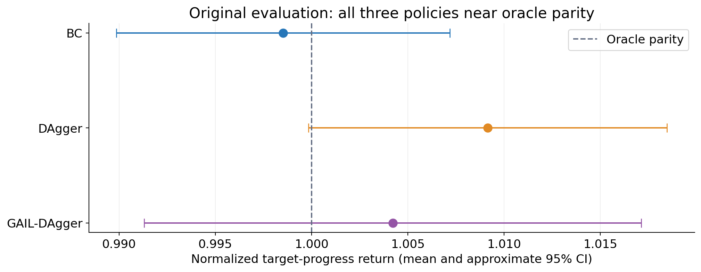
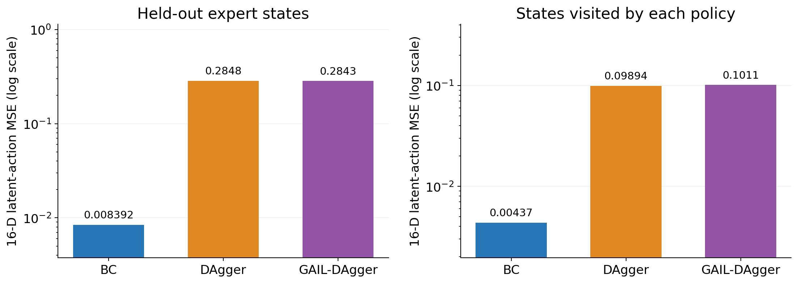
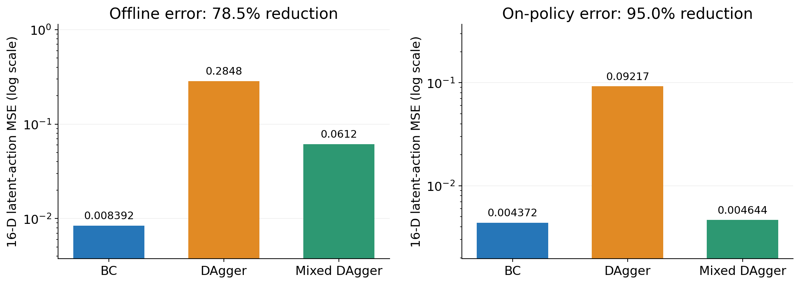
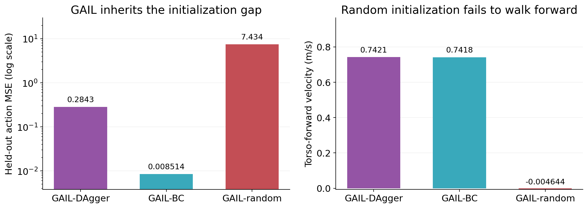
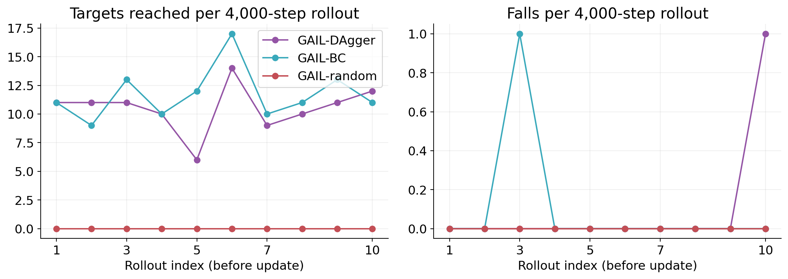
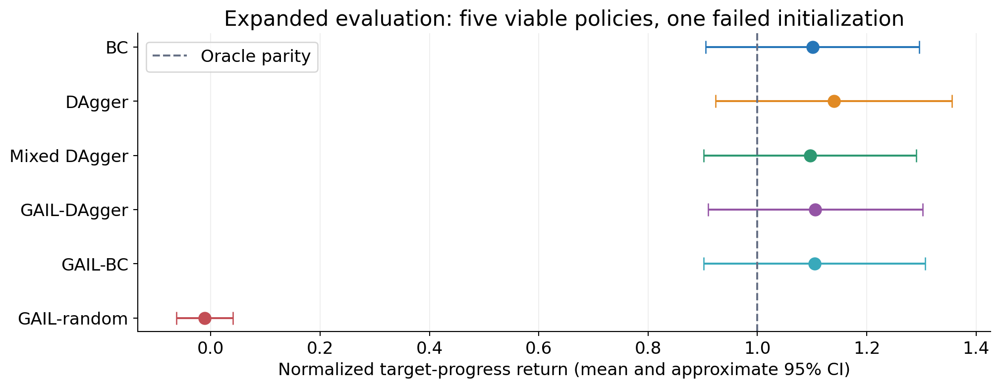
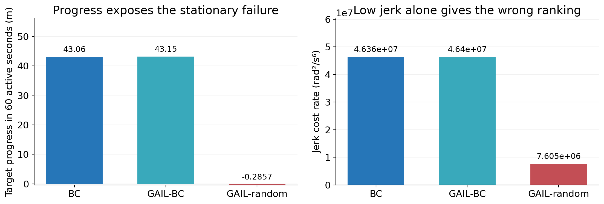

# Original comparison: similar walking, different fidelity

- Behavioural cloning (BC), DAgger, and GAIL all achieved task returns near FC Portugal.
- BC reproduced the expert's actions much more closely.
- Follow-up experiments examined DAgger's seed data and GAIL's actor initialization.

::: notes
This presentation covers completed nominal-domain experiments only. The order is the original comparison, the diagnostic history behind those results, the questions they raised, and the subsequent model variants. “Original GAIL” is called GAIL-DAgger throughout because its actor was initialized from DAgger. The original comparison uses the archived evaluation; the expanded comparison uses the current evaluation. These are distinct batches and are not pooled.
:::

# What was evaluated?

| Component | Experimental setup |
|---|---|
| Expert | Native FC Portugal Walk controller |
| Learner interface | 63 observations → 16 latent walking actions |
| Task | Reach successive targets within the player's own half |
| Evaluation | Five seeds: 101, 202, 303, 404, 505 |
| Duration | 3,000 active steps / 60 seconds per seed |
| Baselines | FC Portugal and uniform-random latent actions |

::: notes
Simulation used synchronous agent control with real-time mode disabled. Recovery cycles were excluded from active evaluation duration. Latent actions pass through the existing walking controller; they are not direct 22-joint commands. Policies were frozen during evaluation and GAIL used its deterministic actor mean. The five seeds measure rollout variation for the available trained policies, not variation across independently trained replicas.
:::

# Performance and imitation answer different questions

- **Task return:** cumulative target-directed progress.
- **Normalized return:** `(policy − random) / (oracle − random)`, calculated per seed.
- **Offline Action MSE:** agreement with the oracle on held-out expert states.
- **On-policy Action MSE:** agreement on states the evaluated policy visits.
- **Mechanical outcomes:** forward velocity, falls, joint occupancy, and jerk.

::: notes
Random defines normalized return 0 and FC Portugal defines 1; scores are not clipped. Offline MSE uses the fixed 10,000-sample expert test partition from a 100,000-sample collection; 90,000 samples are in the training partition. The split uses contiguous 250-step blocks. Both MSE measures concern the 16 latent action dimensions. Joint occupancy distance is standardized 22-D sliced Wasserstein-1 with 256 projections, not a time-aligned trajectory error. Error bars reproduce saved normal-approximation intervals: mean ± 1.96 × sample standard deviation / sqrt(5). They are descriptive uncertainty estimates with a small sample, not a formal paired comparison or equivalence test.
:::

# Original policies and training investment

| Policy | Starting data / initialization | Additional training rollouts |
|---|---|---:|
| BC | 90,000 expert training samples; long and short targets | 0 |
| DAgger | 20,000 long-target expert seed samples | 70,000 steps |
| GAIL-DAgger | Trained DAgger actor + static FC Portugal demonstrations | 40,000 steps |

- Original DAgger ended with 90,000 oracle labels.
- GAIL used FC Portugal occupancy as its expert dataset.

::: notes
The BC actor is a 63 → 256 → 256 → 16 ReLU network trained with MSE and Adam, retaining the best validation checkpoint. DAgger used seven 10,000-step iterations with oracle execution probabilities 0.8, 0.6, 0.4, 0.2, 0, 0, 0. Every visited state was oracle-labelled. GAIL used ten 4,000-step rollout/update iterations. DAgger initializes the GAIL actor; the DAgger aggregate is not the GAIL expert occupancy dataset. Rollout counts exclude the original demonstration collection and final evaluation.
:::

# Original result: task return near oracle parity

{width=90%}

- BC: **0.9985**; DAgger: **1.0092**; GAIL-DAgger: **1.0042**.
- All three intervals include oracle parity; these results establish no return winner.

::: notes
Original archived batch: BC CI [0.9899, 1.0072]; DAgger [0.9998, 1.0185]; GAIL-DAgger [0.9913, 1.0171]. The oracle's normalized value is exactly 1 by definition, not a claim that its physical performance has no uncertainty. The random baseline had negative forward velocity and 32.6 falls per active minute, providing a meaningful failure floor. Source: archived comparison.csv and PHASE1_ORIGINAL_3_REPORT.md.
:::

# Original result: BC was the most faithful imitation

{width=95%}

- Offline MSE: **0.0084 BC**, **0.2848 DAgger**, **0.2843 GAIL-DAgger**.
- Comparable walking return coexisted with roughly **34×** different offline action error.

::: notes
On-policy MSE was 0.00437 for BC, 0.09894 for DAgger, and 0.10111 for GAIL-DAgger. Sliced Wasserstein distances were 0.0356, 0.0617, and 0.0587 respectively. The evidence distinguishes task competence from faithful reproduction of the oracle's latent action mapping. Offline MSE is one fixed test-set estimate per checkpoint; the chart does not imply a training-seed confidence interval.
:::

# Original mechanical results and interpretation

| Policy | Forward velocity (m/s) | Falls across five active minutes | Joint occupancy distance |
|---|---:|---:|---:|
| FC Portugal | 0.734 | 0 | 0.0000 |
| BC | 0.734 | 0 | 0.0356 |
| DAgger | 0.742 | 1 | 0.0617 |
| GAIL-DAgger | 0.734 | 0 | 0.0587 |

- BC combined reliable locomotion, close imitation, and the lowest extra rollout cost.
- GAIL retained locomotion but did not close DAgger's action-error gap.

::: notes
One observed fall versus zero is too little evidence to establish a reliable reduction in fall risk. GAIL-DAgger had slightly lower mean jerk than BC and DAgger in this batch, but that alone is not evidence of better walking. Joint occupancy distances are relative to the oracle traces in this evaluation batch.
:::

# Diagnostic history: early GAIL completion hid failure

| Early-run diagnostic | Observed outcome |
|---|---|
| Discriminator classification | Approximately 99.8% accuracy by iteration 10 |
| PPO approximate KL | Approximately 1,159 at iteration 10 |
| Expert-dataset actor MSE | Approximately 0.47 → 4.50 |
| Mechanical behavior | 44 falls at rollout 8; zero targets at rollout 10 |

- Training finished, but the actor deteriorated.
- These superseded diagnostics explain the stabilization work behind the successful comparison.

::: notes
Source: CHALLENGES.md sections 4.1–4.4. These are historical diagnostics, not the final five-seed policy results and not a matched ablation. Some early fall counts also suffered from height-only detection. Training rollout N is collected before update N; it does not evaluate checkpoint N. Target seeds vary between training rollouts.
:::

# Stabilization restored useful GAIL training

- Normalize discriminator inputs; add regularization and non-saturating rewards.
- Separate actor/critic optimization; enforce KL stopping and rollback.
- Add a small decaying BC anchor and torso-angle fall detection.

| Clean GAIL-DAgger run | Recorded outcome |
|---|---|
| Accepted PPO KL | 0.00838–0.01161 |
| Expert-dataset actor MSE | 0.26782–0.26832 |
| Locomotion | 6–14 targets per rollout; one fall over 40,000 steps |

::: notes
Source: CHALLENGES.md sections 4.1–4.5 and the archived successful GAIL training artifacts. Discriminator classification loss remained 1.3570–1.5119. These interventions were combined; the record does not isolate each intervention's causal contribution. Stable training preserved the DAgger initialization's fidelity level rather than approaching BC's. Training-dataset MSE here is a different measurement from held-out test MSE in the comparison slides.
:::

# The original findings motivated two follow-up tests

| Finding | Question | Completed modification |
|---|---|---|
| DAgger had high action error despite good return | Was initial demonstration coverage inadequate? | Larger, balanced long/short DAgger seed |
| GAIL retained DAgger's action error | How much does actor initialization determine the outcome? | GAIL from BC and from random weights |

- The follow-ups retained the nominal walking task and common evaluation protocol.
- Changes targeted training data and initialization.

::: notes
These are the actual directions taken after the original results. “Modified models” refers to the completed mixed-seed DAgger and GAIL initialization variants. Mixed-seed DAgger changes two factors at once: seed composition and sample count. GAIL variants retain expert occupancy, the auxiliary BC anchor, and the shared training settings; they are initialization controls within this implemented GAIL pipeline.
:::

# Follow-up 1: richer DAgger seed demonstrations

| Setting | Original DAgger | Mixed-seed DAgger |
|---|---:|---:|
| Initial oracle samples | 20,000 | 100,000 |
| Initial target coverage | Long-range | 50% long-range / 50% short-turn |
| Aggregation rollouts | 7 × 10,000 | 7 × 10,000 |
| Oracle execution schedule | 0.8 → 0 | Same schedule |
| Total labelled states | 90,000 | 170,000 |

**Hypothesis:** stronger initial coverage could reduce action error while retaining locomotion.

::: notes
The seven beta values were 0.8, 0.6, 0.4, 0.2, 0, 0, 0. Mixed-seed demonstrations were newly collected. The comparison does not isolate short-turn data from the benefit of 80,000 additional labels. Sources: PIPELINES.md mixed-seed DAgger description and the completed Phase 1 report.
:::

# Mixed-seed DAgger substantially reduced action error

{width=95%}

- Offline MSE: **0.2848 → 0.0612**, a **78.5% reduction**.
- On-policy MSE: **0.09217 → 0.00464**, a **95.0% reduction**.

::: notes
All values on this slide come from the expanded evaluation, including original DAgger's on-policy value. Do not substitute the archived original-batch value of 0.09894. Mixed DAgger's offline error remained about 7.3 times BC's; its on-policy error was only about 6% higher than BC's. Occupancy distance improved from 0.1056 to 0.0808. This supports richer seeding as a useful combined intervention but cannot attribute gains solely to turning coverage.
:::

# Mixed-seed DAgger retained walking performance

| Expanded evaluation | Original DAgger | Mixed DAgger | BC |
|---|---:|---:|---:|
| Normalized return | 1.140 | 1.096 | 1.101 |
| Forward velocity (m/s) | 0.757 | 0.731 | 0.734 |
| Falls / active minute | 0 | 0 | 0 |
| Oracle labels | 90,000 | 170,000 | 90,000 |

- The improvement was in imitation fidelity, with no established return advantage.
- It required **80,000 additional labels** and the same 70,000 aggregation steps.

::: notes
Mixed DAgger CI [0.902, 1.290], original DAgger [0.923, 1.356], BC [0.906, 1.296]. The intervals overlap substantially. Close on-policy error but higher offline error suggests residual errors are concentrated in held-out expert states rather than the policy's usual visited states; this is an interpretation, not a directly tested state-coverage decomposition.
:::

# Follow-up 2: change GAIL's actor initialization

{width=95%}

- **GAIL-BC:** preserved BC-level fidelity and useful locomotion.
- **GAIL-DAgger:** retained the original DAgger fidelity gap.
- **GAIL-random:** failed to develop forward locomotion within 40,000 steps.

::: notes
All three variants used the static 90,000-sample FC Portugal expert dataset, the BC anchor, and ten 4,000-step rollouts under shared PPO/discriminator settings. Test MSE: 0.008514 GAIL-BC, 0.284269 GAIL-DAgger, 7.433601 GAIL-random. Forward velocity: 0.7418, 0.7421, and −0.00464 m/s respectively. This is evidence about these initializers under the shared budget/settings, not proof that randomly initialized GAIL cannot learn under other settings. The implementation includes auxiliary BC supervision, so these results should not be described as a pure adversarial-only ablation.
:::

# Training diagnostics support the initialization result

{width=95%}

- GAIL-random reached **zero targets in every rollout**.
- Numerically stable optimization did not guarantee locomotion.

::: notes
Data come from archived GAIL-DAgger artifacts and artifacts/gail_bc and artifacts/gail_random. Every point represents 4,000 active training steps collected BEFORE the indicated update. Rollout 10 therefore measures the iteration-9 actor, not the final iteration-10 actor. These diagnostic curves are not controlled checkpoint rankings because target seeds change between rollouts. GAIL-BC accepted KL stayed around 0.00772–0.00988 with no rollbacks; GAIL-random accepted KL was approximately 0.0008–0.00214. Conservative settings protected pretrained actors but did not bootstrap the random actor in this experiment.
:::

# Expanded evaluation: five viable policies, one failure

{width=90%}

- Five learned policies remained compatible with oracle-level return.
- GAIL-random scored **−0.011**, near the random floor.

::: notes
Expanded mean [95% CI]: BC 1.101 [0.906,1.296]; DAgger 1.140 [0.923,1.356]; mixed DAgger 1.096 [0.902,1.290]; GAIL-DAgger 1.106 [0.910,1.302]; GAIL-BC 1.104 [0.902,1.307]; GAIL-random −0.011 [−0.063,0.040]. The expanded oracle experienced one fall across five active minutes, compared with none in the archived original batch. Its mean target progress was 40.44 m in the expanded batch. Different baseline realizations partly explain means above 1 and broader intervals. An increase from an archived score near 1.00 to a current score near 1.10 is not evidence that the same checkpoint improved. Simulator rollouts are not bitwise deterministic even with the same evaluation seed.
:::

# Zero falls and low jerk can describe failure

{width=95%}

- GAIL-random had **zero recorded falls**, but **−0.286 m target progress**.
- Its much lower jerk did not represent successful walking.

::: notes
The comparison is based on final expanded evaluation, not training-rollout diagnostics. BC and GAIL-BC achieved about 43 m target progress per active minute. GAIL-random's jerk cost rate was approximately 7.60 million rad²/s⁶ versus about 46.4 million for BC and GAIL-BC. “Stationary failure” means a lack of useful net locomotion, not an assertion that every joint and the body were motionless: planar motion can occur without target progress. Jerk was computed with the same five-sample smoothing and reset exclusions across policies.
:::

# Cost: distinguish additional work from inherited supervision

| Policy | Oracle-labelled training data | Extra rollout steps beyond demonstration collection |
|---|---|---:|
| BC | 90,000 static samples | 0 |
| DAgger | 20,000 seed + 70,000 queried | 70,000 |
| Mixed DAgger | 100,000 seed + 70,000 queried | 70,000 |
| GAIL-BC | Static expert data + BC initializer | 40,000 |
| GAIL-DAgger | Static expert data + DAgger initializer | 110,000 including DAgger |
| GAIL-random | 90,000 static expert samples | 40,000 |

::: notes
All GAIL variants made zero additional active oracle queries during adversarial training, but every variant consumed the expert dataset. GAIL-BC reuses the BC training data; do not count the same dataset twice as new labels. GAIL-DAgger inherits the 90,000-label DAgger pipeline in addition to access to the static expert dataset. The table describes dataset provenance rather than claiming a deduplicated end-to-end count. The held-out expert samples, training compute, resets, demonstration collection steps, and evaluation runs are not included in the rollout column. These are sample-cost comparisons, not measured wall-clock or energy comparisons.
:::

# Conclusions from the completed experiments

- **BC:** strongest nominal fidelity and simplest training cost profile.
- **Mixed DAgger:** substantially better imitation than original DAgger, at greater label cost.
- **GAIL:** largely preserved the quality of its actor initialization.
- **Random-start GAIL:** stable optimization without successful locomotion.
- **Evaluation:** return, imitation, and mechanics must be interpreted together.

::: notes
No reliable task-return winner is established by the reported intervals. Claims concern the available checkpoints in the nominal simulator setting. The study has five rollout seeds per final policy, a combined size/composition change for mixed DAgger, and no independent multi-seed training replication. No future project directions are included in this presentation.
:::

# Appendix: result sources and figure provenance

- Original results: [original-three-policy report](../../experiments/archive_20260905_pre_variants/gail_dagger/evaluation/PHASE1_ORIGINAL_3_REPORT.md).
- Expanded results: [completed Phase 1 report](../PHASE1_RESULTS_REPORT.md).
- Numerical sources: [original CSV](../../experiments/archive_20260905_pre_variants/gail_dagger/evaluation/comparison.csv) and [expanded CSV](../comparison.csv).
- Engineering history: [CHALLENGES.md](../../CHALLENGES.md); experimental methods: [PIPELINES.md](../../PIPELINES.md).
- All seven figures are supplied as PNG and PDF in `figures/`.

::: notes
Figures 01–02 use the original archived aggregate CSV. Figures 03–04 and 06–07 use the expanded CSV. Figure 05 uses saved per-iteration rollout metrics for the three GAIL initializations. generate_figures.py reproduces the figures without training or running the simulator. Existing full evaluation dashboards remain in the original archive and evaluation/evaluation_summary.png, but the focused figures here are sized for slides.
:::
